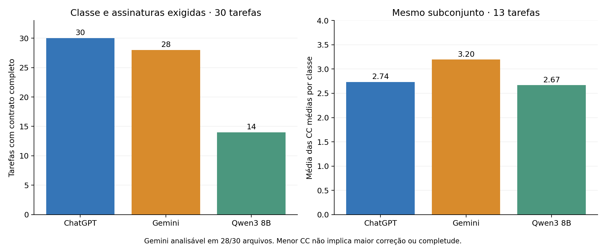

# Análise estática dos códigos gerados

Projeto avaliacao-codigo-llms · Disciplina DOO  
Autor do projeto Gustavo Silva Campos  
Fonte dos dados https://github.com/gscamposz/avaliacao-codigo-llms  
Snapshot analisado f4c7ecd69986cc6d987611e253ef4d05be30b0bc

## Escopo

Foram analisadas 90 respostas, sendo 30 de ChatGPT, 30 de Gemini e 30 de Qwen3 8B. As 30 soluções de referência do ClassEval também foram medidas como controle descritivo. O piloto ficou fora dessa amostra.

A análise usou exatamente as cópias normalizadas do pacote de testes funcionais anterior. Os hashes SHA-256 dessas cópias foram verificados antes do cálculo. Esta etapa não executou novas gerações e não corrigiu implementações.

As entradas incluem respostas originais, cópias normalizadas e as especificações necessárias para reproduzir a análise. O repositório remoto não recebeu commits ou uploads nesta etapa.

## Ferramentas e regras

Python 3.12.14 e Radon 6.0.1. A versão efetiva de Python e a plataforma estão em tabelas/ambiente.json.

| Medida | Definição operacional |
|---|---|
| AST válida | ast.parse consegue gerar a árvore do arquivo inteiro. Arquivo inválido recebe erro e valores indisponíveis para métricas que exigem AST. |
| Classe esperada | Há declaração de classe no nível do módulo com o nome exato exigido na especificação. |
| Contrato completo | A classe esperada declara todos os métodos exigidos com as assinaturas preservadas. Isso é conformidade estrutural, sem garantia funcional. |
| NOM | Número de declarações def/async def diretamente no corpo de cada classe. Inclui __init__, métodos especiais, estáticos e de classe. Funções internas e métodos herdados não entram. |
| NPM | Subconjunto do NOM cujo nome não começa com underscore. É convenção Python para esta pesquisa. Métodos especiais como __init__ ficam fora de NPM. |
| CC | Complexidade ciclomática por método, calculada pelo Radon 6.0.1. A base é 1 e estruturas de decisão adicionam caminhos conforme as regras da ferramenta. |
| WMC-CC | Soma da CC dos métodos diretamente declarados em uma classe. Usada como medida descritiva derivada. |
| SLOC | Linhas de código-fonte segundo radon.raw.analyze. Disponíveis por arquivo. |

Também foi exportado NOM sem __init__, para permitir comparação com estudos que excluem o construtor.

Assinaturas são comparadas por nome de método, parâmetros posicionais e exclusivamente nomeados, defaults, variáveis *args/**kwargs e decoradores staticmethod/classmethod. Anotações de tipo e decoradores diferentes desses dois não fazem parte deste critério. Métodos adicionais são contados no NOM e não invalidam a preservação das assinaturas exigidas.

Cada declaração direta é contada uma vez. Não se soma o bloco agregado de classe fornecido pelo Radon aos seus métodos, evitando duplicação. Funções no nível do módulo são contadas separadamente, sem serem convertidas em métodos. Classes internas ficam fora do recorte de classes no nível do módulo.

Nos arquivos sem a classe esperada, a ausência é registrada. As classes efetivamente declaradas continuam tendo NOM/NPM/CC medidos, com a identificação original. Para arquivos com sintaxe inválida, as métricas ficam indisponíveis, sem atribuição artificial de complexidade zero.

## Resultado geral

| Modelo | Sintaxe após preparação | Classe esperada | Contrato completo | NOM total | NPM total | CC média por método | CC máxima |
|---|---:|---:|---:|---:|---:|---:|---:|
| ChatGPT | 30/30 | 30/30 | 30/30 | 152 | 122 | 3,65 | 24 |
| Gemini | 28/30 | 28/30 | 28/30 | 145 | 116 | 3,65 | 26 |
| Qwen3 8B | 29/30 | 16/30 | 14/30 | 115 | 92 | 2,63 | 13 |

NOM e NPM totais somam as classes declaradas nos arquivos analisáveis. As médias de CC são ponderadas por método, ou seja, cada método tem peso igual. Os conjuntos diferem em completude e quantidade de métodos, portanto essas médias globais não estabelecem um ranking de qualidade.

No controle com as 30 soluções de referência, foram encontrados 150 métodos e 121 públicos pela convenção adotada. A CC média dos métodos foi 3,20 e a máxima foi 44. Essa referência é contexto estrutural, sem expectativa de que todos os modelos reproduzam exatamente sua implementação.

## Comparação com tarefas pareadas

Foi formado um subconjunto de tarefas em que os três modelos preservaram a classe e todas as assinaturas. As mesmas 13 tarefas foram usadas em cada linha. Para CC, calcula-se primeiro a média dos métodos da classe esperada e depois a média entre tarefas, dando o mesmo peso a cada tarefa.

| Modelo | Tarefas pareadas | NOM médio | NPM médio | WMC-CC médio | Média das CC médias por classe |
|---|---:|---:|---:|---:|---:|
| ChatGPT | 13 | 5,00 | 4,15 | 13,15 | 2,74 |
| Gemini | 13 | 5,08 | 4,15 | 15,38 | 3,20 |
| Qwen3 8B | 13 | 5,00 | 4,15 | 12,54 | 2,67 |

IDs do subconjunto ClassEval_4, ClassEval_7, ClassEval_8, ClassEval_13, ClassEval_24, ClassEval_29, ClassEval_35, ClassEval_61, ClassEval_64, ClassEval_67, ClassEval_68, ClassEval_75, ClassEval_86.

Esse pareamento controla parte da diferença de tarefas e do contrato. Ele é um subconjunto selecionado por conformidade estrutural e não representa as 30 tarefas completas. Mesmo nesse conjunto, preservação estrutural não garante comportamento correto.

## Métodos com maior complexidade observada

| Modelo | Tarefa | Método | CC | Faixa Radon |
|---|---|---|---:|---|
| Gemini | ClassEval_39 | ExpressionCalculator.prepare | 26 | D |
| ChatGPT | ClassEval_54 | MahjongConnect.has_path | 24 | D |
| ChatGPT | ClassEval_39 | ExpressionCalculator.prepare | 23 | D |
| Gemini | ClassEval_54 | MahjongConnect.has_path | 22 | D |
| ChatGPT | ClassEval_65 | NumberWordFormatter.format_string | 20 | C |
| Gemini | ClassEval_86 | TicTacToe.check_winner | 18 | C |
| ChatGPT | ClassEval_58 | MinesweeperGame.generate_mine_sweeper_map | 17 | C |
| ChatGPT | ClassEval_86 | TicTacToe.check_winner | 16 | C |

As faixas Radon são A (1–5), B (6–10), C (11–20), D (21–30), E (31–40) e F (41 ou mais). Elas são rótulos da ferramenta, sem constituir critérios de aprovação deste experimento.

## Interpretação

ChatGPT apresentou a classe e todas as assinaturas exigidas nas 30 tarefas. Isso coexiste com as falhas funcionais já registradas. Gemini preservou o contrato nas 28 tarefas que puderam ser analisadas após preparação. As tarefas 5 e 71 continuam sem métricas dependentes de AST porque a formatação disponível não permite análise confiável.

Qwen3 apresentou a classe esperada em 16 tarefas, com contrato completo em 14. Há classes renomeadas e trechos que contêm apenas funções, além de um arquivo de sintaxe inválida. A menor CC média acompanha uma redução no número de métodos e diferenças de cobertura do contrato. Portanto, esse resultado exige leitura junto à completude e aos testes funcionais.

Nas três respostas analisáveis da tarefa ComplexCalculator, o construtor vazio foi identificado pelo detector de corpos vazios. O mesmo padrão existe na solução de referência. Corpo vazio nessa situação não comprova implementação incompleta.

## Formatação, benchmark e limitações

- A sintaxe dos textos brutos foi válida em 30 arquivos do ChatGPT, 0 do Gemini e 3 do Qwen3. Markdown e perda de indentação tornam esse indicador dependente da forma de exportação. Ele não deve ser interpretado isoladamente como capacidade de programação.
- As regras de preparação são as mesmas dos testes funcionais. Cada transformação está registrada em entradas/manifesto_funcional.json e por_arquivo.csv. Nas entradas do Gemini, a recuperação do recuo foi necessária. As tarefas 5 e 71 seguem pendentes de confirmação contra a conversa original.
- ClassEval_42 do Qwen3 tem sintaxe inválida. ClassEval_58 pode ser analisado estaticamente, mas não declara a classe esperada e utiliza self no nível do módulo, causando falha funcional de carregamento. Esses estados são diferentes.
- O esqueleto oficial de ClassEval_5 contém a classe dentro de uma string. ClassEval_22 tem aspas triplas defeituosas, e ClassEval_43 contém uma descrição com sintaxe inválida. Para esses três casos, as assinaturas esperadas foram lidas exclusivamente das linhas def do esqueleto original. O texto dos prompts e as respostas não foram alterados.
- Comparações de defaults são estruturais via AST. Expressões equivalentes escritas de formas diferentes podem ser classificadas como assinatura alterada.
- Só existe uma geração por modelo e tarefa. Não foram realizados testes de significância, inferências causais ou estimativas de superioridade geral.
- Identificadores exatos de ChatGPT e Gemini, configurações e datas da coleta devem ser confirmados no relatório final. Os nomes das pastas não estabelecem as versões.
- A análise herda as limitações dos testes funcionais, incluindo a falha de referência no teste de calendário e a sensibilidade de jogos a sementes aleatórias.
- CC, NOM e NPM descrevem propriedades estruturais. Não substituem testes de correção, avaliação de coesão ou revisão de requisitos.
- A composição dos requisitos e a estrutura predefinida do ClassEval influenciam NOM/NPM e devem ser consideradas na discussão.
- As tabelas de referência e dos modelos estão identificadas separadamente por uma coluna de modelo.

## Evidências e reprodução

1. Instale Radon com python -m pip install -r requirements.txt.
2. Execute python calcular_metricas.py na pasta extraída.
3. Para gerar a figura e este relatório, instale também matplotlib==3.10.8 e execute python gerar_relatorio.py. A figura entregue foi gerada com a versão efetiva registrada em requisitos_figura.txt.

O cálculo é estático e não executa os programas dos modelos. O script inclui verificações de contagem com construtor, método privado, método estático, método assíncrono e CC de expressão booleana. Hashes das entradas são validados a cada execução.

Arquivos principais

- tabelas/por_arquivo.csv — estado de sintaxe, classe esperada, contrato, NOM/NPM, CC e vínculo com o resultado funcional.
- tabelas/por_classe.csv — NOM/NPM, WMC-CC e distribuição por classe.
- tabelas/por_metodo.csv — CC, faixa Radon, convenção de visibilidade e corpo vazio por método.
- tabelas/assinaturas.csv — comparação de cada assinatura exigida.
- tabelas/resumo_modelos.csv — totais e médias globais.
- tabelas/comparacao_pareada.csv — comparação das mesmas 13 tarefas.
- tabelas/ambiente.json — versões e snapshot.
- As mesmas tabelas estão disponíveis em JSON.

## Fontes

Radon, introdução às métricas  
https://radon.readthedocs.io/en/latest/intro.html

Radon, API e classificações de complexidade  
https://radon.readthedocs.io/en/latest/api.html

Implementação Radon 6.0.1  
https://github.com/rubik/radon/tree/v6.0.1/radon

Python, módulo ast  
https://docs.python.org/3/library/ast.html

Python, PEP 8 e convenções de nomes públicos e internos  
https://peps.python.org/pep-0008/

ClassEval, dados e especificações  
https://github.com/FudanSELab/ClassEval

## Próximos passos para concluir o trabalho

1. Conferir os originais do Gemini nas tarefas 5 e 71 e resolver somente perdas de transferência/formatação. Preservar as respostas brutas e registrar o que for ajustado. Reexecutar as análises dessas cópias para fechar a coleta.
2. Confirmar nomes/versões dos modelos, datas, configurações locais do Ollama e eventuais retomadas após timeout. Identificar se todos os prompts foram iguais aos arquivos versionados.
3. Submeter estas métricas à aprovação do autor antes do upload no repositório.
4. Integrar resultados funcionais e estáticos, explicitando denominadores, falhas de carregamento e limitações do benchmark.
5. Redigir introdução, fundamentação, metodologia, resultados, discussão, limitações, conclusão e referências, justificando tarefas, linguagem, modelos, técnica de prompt e métricas.
6. Atualizar o README e incluir comandos de reprodução, dependências, licenças e referências. Criar uma versão final identificada por commit ou tag.
7. Preparar a apresentação e uma demonstração curta de um caso que passou e de um que falhou.

A autorização para upload ainda está pendente. Esta etapa entregou os resultados como pacote para revisão.
