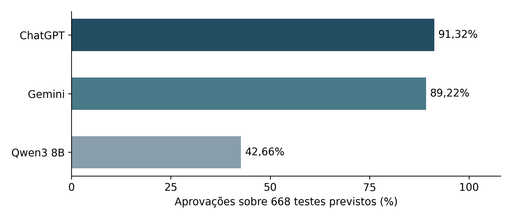

# Avaliação funcional e estática de classes Python geradas por modelos de linguagem

Gustavo Silva Campos. IF Sudeste MG, Campus Manhuaçu. Sistemas de Informação. Professor Filipe. 2026.

# 1 INTRODUÇÃO

A geração automática de código coloca uma questão prática para o desenvolvimento orientado a objetos: uma implementação produzida a partir de uma especificação preserva a interface da classe e apresenta o comportamento esperado? Um programa pode ter sintaxe válida, nomes plausíveis e organização legível e, ainda assim, falhar quando diferentes métodos precisam compartilhar e modificar o mesmo estado. Por isso, avaliar apenas a aparência da resposta oferece evidência insuficiente sobre sua utilidade.

Este trabalho compara respostas de três modelos de linguagem para 30 tarefas de implementação de classes Python do ClassEval. O conjunto de dados foi escolhido por reunir esqueletos de classes, descrições de métodos, exemplos e testes automatizados. Du et al. (2023) apresentam o ClassEval como um benchmark voltado à geração em nível de classe, ampliando o foco de avaliações centradas em funções isoladas. Essa característica aproxima o material dos conteúdos da disciplina de Desenvolvimento Orientado a Objetos.

A comparação reúne o ChatGPT, identificado pelo autor como GPT-6, o Gemini acessado pelo navegador e o Qwen3 8B executado localmente por meio do Ollama. A coleta ocorreu entre 9 e 21 de novembro de 2026, conforme informação do autor. Foram preservadas 90 respostas, uma para cada combinação de tarefa e modelo. As tarefas Calculator e VendingMachine compuseram um piloto separado e não entram nos resultados da amostra principal.

A pergunta de pesquisa é: como as respostas dos três modelos diferem quanto à aprovação nos testes oficiais, à preservação do contrato estrutural e à complexidade das classes implementadas? Para respondê-la, o estudo combina execução funcional e análise estática. A primeira observa o comportamento sob os casos previstos pelo benchmark. A segunda examina classes, assinaturas e medidas de estrutura, independentemente da execução.

A contribuição deste estudo está na comparação rastreável das respostas coletadas, com preservação dos arquivos originais e explicitação dos ajustes de formatação. Os resultados mostram maior quantidade de testes aprovados pelo ChatGPT nesta amostra, seguido do Gemini e do Qwen3 8B. Entretanto, os números também revelam que preservar assinaturas não garante correção funcional e que uma complexidade média menor pode acompanhar implementações incompletas. A interpretação permanece restrita ao protocolo e aos artefatos analisados.

# 2 OBJETIVOS

## 2.1 Objetivo geral

Comparar a correção funcional e as características estruturais de classes Python geradas por ChatGPT, Gemini e Qwen3 8B a partir de 30 especificações do ClassEval, utilizando um protocolo comum de solicitação e avaliação.

## 2.2 Objetivos específicos

Selecionar tarefas que envolvam utilitários, regras de negócio e jogos ou simulações, mantendo diversidade de comportamentos dentro de um escopo viável para análise individual.

Aplicar o mesmo modelo de prompt aos três sistemas e preservar as respostas coletadas, separando os arquivos originais das cópias preparadas para execução.

Executar os testes oficiais das tarefas selecionadas e registrar aprovações, falhas de asserção, erros durante os testes e casos que não chegaram a executar.

Verificar a sintaxe e a preservação de classes e assinaturas por meio da árvore sintática abstrata, além de calcular a complexidade ciclomática, a quantidade de métodos e a quantidade de métodos públicos segundo convenções explícitas.

Relacionar os resultados funcionais às medidas estáticas, discutir discrepâncias e apresentar as limitações de validade e reprodução do experimento.

# 3 FUNDAMENTAÇÃO TEÓRICA

## 3.1 Classes e contratos em Python

Classes permitem reunir dados e operações em uma mesma abstração. Em Python, instâncias podem manter atributos próprios e utilizar métodos para consultar ou modificar esse estado (Python Software Foundation, s.d.a). Nesse contexto, uma implementação de classe precisa manter consistência entre o que o construtor inicializa e o que os demais métodos pressupõem. Métodos corretos quando examinados isoladamente podem falhar quando dependem de atributos ausentes ou de atualizações incompatíveis.

Neste estudo, contrato estrutural designa o nome da classe e as assinaturas exigidas pelo esqueleto. Trata-se de uma definição operacional: a verificação não comprova pré-condições, pós-condições ou invariantes comportamentais. Uma assinatura preservada apenas permite que o avaliador encontre e invoque o método conforme a interface esperada. Essa distinção fundamenta o uso complementar dos testes funcionais.

A biblioteca padrão oferece recursos adequados à análise. O módulo ast representa a estrutura sintática do código, permitindo identificar declarações de classes e métodos (Python Software Foundation, s.d.b). O módulo unittest organiza casos de teste, preparação do ambiente e execução de suítes (Python Software Foundation, s.d.c). A disponibilidade desses recursos favorece a inspeção automatizada sem introduzir dependências externas no código solicitado aos modelos.

## 3.2 Modelos de linguagem e solicitação por instruções

Modelos de linguagem podem produzir código a partir de instruções e contexto textual. Brown et al. (2020) distinguem configurações de interação de acordo com a quantidade de demonstrações fornecidas no contexto. Neste trabalho, zero-shot significa que o prompt não inclui uma solução completa de outra tarefa para servir como demonstração. Os exemplos de entrada e saída presentes nas docstrings são mantidos como parte da especificação original.

A geração é solicitada de forma integral: cada resposta deve conter a classe completa. Não se solicita uma sequência de implementações método a método nem uma revisão orientada pelos testes. Essa escolha reduz a quantidade de interações necessárias, mas também exige que o modelo considere simultaneamente todas as assinaturas e dependências internas. O estudo de Du et al. (2023) discute diferentes estratégias de geração em nível de classe; seus resultados não são transferidos automaticamente aos modelos e condições aqui utilizados.

A família Qwen3 disponibiliza modelos com diferentes tamanhos e modos de geração, conforme Yang et al. (2025). O presente experimento utiliza apenas a variante identificada como qwen3:8b nos registros do Ollama. As propriedades e os resultados apresentados no relatório técnico da família não substituem a medição desta execução local. Para ChatGPT e Gemini, a interface de navegador limita a recuperação dos parâmetros efetivos e de identificadores internos da versão servida.

## 3.3 Testes funcionais e medidas estáticas

Testes funcionais verificam saídas e efeitos observáveis diante de entradas determinadas. Uma aprovação indica compatibilidade com os casos executados, sem demonstrar ausência de defeitos para todas as entradas possíveis. No ClassEval, os testes permitem comparar implementações sob uma mesma referência de comportamento. A execução das soluções de referência também funciona como controle para identificar problemas do próprio conjunto de testes.

A complexidade ciclomática descreve a estrutura de decisões do código. Na operacionalização do Radon, a medida parte de um valor básico e cresce conforme construções de decisão identificadas na AST (Radon, s.d.). Ela auxilia a localizar métodos com mais caminhos de controle, mas não mede diretamente legibilidade, correção, tempo de execução ou qualidade do projeto. Sua interpretação exige conhecer a funcionalidade efetivamente implementada.

NOM representa a quantidade de métodos declarados e NPM a quantidade de métodos considerados públicos pela regra deste experimento. A PEP 8 utiliza o prefixo underscore como convenção de interface não pública (Van Rossum; Warsaw; Coghlan, 2001). Como Python não aplica o mesmo sistema de modificadores de acesso de linguagens como Java, o uso de NPM exige explicitar essa convenção. Valores maiores ou menores não constituem, isoladamente, evidência de melhor orientação a objetos.

# 4 METODOLOGIA

## 4.1 Delineamento e seleção das tarefas

O estudo é comparativo, quantitativo e descritivo, com inspeção qualitativa de casos que ajudam a explicar os resultados. A unidade de geração é uma resposta completa para uma tarefa. A unidade principal de comparação é a combinação entre tarefa e modelo, resultando em 90 observações. Não foram realizadas repetições independentes suficientes para estimar a variabilidade de cada combinação.

A seleção foi intencional, com dez tarefas em cada grupo: utilitários e processamento de dados, regras de negócio e jogos ou simulações. Essa divisão distribui a análise entre transformação de dados, manutenção de registros e transições de estado. Ela atende ao mínimo de 30 especificações definido para o trabalho e mantém um volume que permite revisar falhas concretas. A seleção não é aleatória nem proporcional aos domínios do benchmark completo; portanto, não sustenta representatividade estatística de todas as tarefas de programação.

A relação completa das classes consta no Apêndice A. Os esqueletos e os testes provêm do arquivo ClassEval_data.json, mantido no repositório do experimento. As duas tarefas do piloto, ClassEval_16 e ClassEval_94, serviram para ajustar o fluxo de coleta, preparação e execução. Seus resultados permanecem separados para evitar mistura entre validação do procedimento e avaliação principal.

## 4.2 Justificativa dos modelos e da linguagem

A escolha dos sistemas considera a viabilidade de acesso no contexto do autor. ChatGPT e Gemini permitem interação pelo navegador, enquanto Qwen3 8B permite geração local em lote com Ollama. Essa composição oferece uma comparação entre duas formas de acesso remoto e uma execução local viável no equipamento disponível. O objetivo não é isolar o efeito da arquitetura, do número de parâmetros ou do provedor, pois essas condições não foram controladas de maneira equivalente.

O nome GPT-6 foi informado pelo autor como a identificação utilizada no ChatGPT. Não há um identificador técnico de versão ou snapshot preservado que confirme independentemente essa seleção. Gemini é mantido como nome do produto, sem atribuição a uma variante não documentada. O identificador qwen3:8b aparece nos 30 registros JSON locais, embora não esteja acompanhado do digest do modelo. As tabelas conservam o rótulo ChatGPT para corresponder aos arquivos do repositório.

Python foi escolhido por ser a linguagem das especificações e dos testes do ClassEval e por permitir analisar classes com recursos da biblioteca padrão. Manter a linguagem original evita que uma tradução das tarefas introduza uma segunda fonte de variação. A execução automatizada e a análise da AST também tornam viável avaliar os 90 artefatos de maneira uniforme. A escolha não implica afirmar superioridade de Python sobre outras linguagens orientadas a objetos.

## 4.3 Prompt e coleta

Utilizou-se um template único em português, seguido do esqueleto original da tarefa. O texto exige a implementação de todos os métodos, a preservação de nomes e assinaturas, o uso da biblioteca padrão e a devolução apenas do código completo. O Apêndice B reproduz o template. As descrições e os exemplos em inglês dos esqueletos foram preservados.

A escolha de zero-shot busca uma condição simples e repetível, sem selecionar exemplos resolvidos que possam favorecer determinado tipo de tarefa. O piloto permitiu verificar o fluxo operacional e identificar problemas de transferência de texto. Ele não constitui uma validação experimental de que esse prompt seja superior a outros. Não houve comparação sistemática com few-shot, role playing ou solicitações de raciocínio encadeado.

O período de coleta informado pelo autor é de 9 a 21 de novembro de 2026. Não foram atribuídas datas individuais às conversas do navegador. No Ollama, os timestamps de conclusão variam de 21/11/2026 às 02:00:22 UTC a 21/11/2026 às 20:56:46 UTC, equivalentes a 20/11 às 23:00 e 21/11 às 17:56 em Brasília. Esse intervalo de aproximadamente 18 horas e 56 minutos entre respostas registradas é compatível com o relato de quase 20 horas de processamento, mas não mede sozinho o tempo total desde o início da primeira solicitação.

A coleta local ocorreu em Windows, em notebook com processador Intel Core i7-1255U, 20 GB de RAM e vídeo integrado Intel Iris Xe, conforme informações fornecidas pelo autor. O procedimento em lote enviava uma requisição independente por tarefa à API local, com stream=false e limite de espera de 3.600 segundos. Há dois registros de timeout para ClassEval_65 e uma resposta final preservada. Essas retomadas são registradas como ocorrências operacionais, sem serem tratadas como amostras adicionais.

## 4.4 Preparação e preservação dos artefatos

As respostas TXT originais foram preservadas. A preparação das cópias executáveis remove cercas Markdown e recupera recuos perdidos na transferência quando necessário, com registro das alterações e hashes. Esse procedimento distingue o material recebido do código usado na avaliação. Não foram corrigidos algoritmos, renomeadas classes ou completados métodos para aumentar a aprovação.

As tarefas ClassEval_5 e ClassEval_71 do Gemini receberam revisão específica da formatação. A sequência de caracteres não brancos, após retirada das cercas, foi preservada nas cópias revisadas. A recuperação de indentação continua sendo uma intervenção relevante em Python e é explicitada como ameaça à validade. O autor confirmou que a tarefa 5 contém literalmente def init(self, text) na resposta original. Esse nome foi mantido, resultando em erros de instanciação; não foi convertido para __init__.

Problemas de sintaxe nos esqueletos das tarefas 5, 22 e 43 exigiram uma alternativa de leitura das linhas de assinatura para a análise estrutural. Isso se restringe à extração do contrato esperado e não modifica o prompt nem a lógica das respostas. O manifesto de revisão e os scripts permitem verificar as regras adotadas.

## 4.5 Protocolo dos testes funcionais

A execução consolidada utiliza Python 3.12.14 em Linux, subprocesso separado por tarefa, diretório temporário, random.seed(0) e limite de 15 segundos por tarefa. As suítes são carregadas a partir dos testes oficiais do arquivo de dados. Espaços excedentes nos nomes das classes de teste são removidos para localizar os objetos definidos, sem alterar as asserções. As soluções de referência das 30 tarefas são executadas sob o mesmo protocolo como controle.

A avaliação registra quatro situações distintas: aprovação, falha de asserção, erro durante o teste e não execução por falha no carregamento. Para cada modelo, há 668 testes previstos. Calculam-se tanto a proporção de aprovações entre os testes executados quanto a proporção sobre o total previsto. Uma tarefa é considerada inteiramente aprovada quando toda a sua suíte prevista executa sem falhas ou erros.

A proporção sobre os testes previstos é definida como 100 × aprovados / 668. A proporção por tarefa é 100 × tarefas integralmente aprovadas / 30. O primeiro indicador dá peso igual aos casos de teste, cujo número varia entre classes. O segundo dá peso igual às tarefas. Eles descrevem perspectivas diferentes e não devem ser confundidos com uma estimativa de pass@k baseada em várias gerações por tarefa.

## 4.6 Métricas estáticas e análise dos dados

A AST verifica se o código preparado pode ser analisado, se a classe esperada existe e se as assinaturas foram preservadas. A comparação considera nomes e categorias dos parâmetros, valores padrão e uso de staticmethod ou classmethod. Anotações de tipo não entram na igualdade de assinaturas. Essa verificação é independente da aprovação funcional.

NOM conta métodos declarados diretamente nas classes analisadas, incluindo construtores, métodos especiais, estáticos e de classe. Métodos herdados e funções internas não são adicionados à contagem. NPM aplica à mesma população o filtro de nomes que não começam por underscore. Por essa definição, __init__ conta em NOM e não em NPM. Essas regras são escolhas operacionais do estudo, e não uma alegação de equivalência universal entre ferramentas de métricas orientadas a objetos.

A complexidade ciclomática é calculada com Radon 6.0.1 para cada método, sem duplicar o agregado da classe. A média global é ponderada pela quantidade de métodos efetivamente analisados. WMC é operacionalizado como a soma das complexidades dos métodos de uma classe. Também são registrados máximos e número de métodos com CC maior que dez. Arquivos que não permitem análise sintática recebem valores ausentes, sem converter ausência em complexidade zero.

Essas métricas foram escolhidas por sua relação direta com as perguntas do estudo: testes observam comportamento; AST verifica interface; NOM e NPM descrevem o tamanho declarado da classe; CC caracteriza decisões internas. Não se calculou um índice único de qualidade que misture essas dimensões. A restrição de biblioteca padrão vale para as respostas geradas; Radon e Matplotlib são ferramentas externas usadas na avaliação e na visualização.

Como análise complementar, compararam-se as mesmas 13 tarefas com contrato completo nos três modelos. Nesse recorte, a média das CC médias por classe atribui peso igual às tarefas. O recorte controla a diferença de composição, mas seleciona casos de maior completude estrutural. Os resultados são descritivos, sem testes de significância ou inferências causais. O snapshot de evidência utilizado neste relatório é f7a439fc46299f5379a2587ba9f70ee2968917eb do repositório de Campos (2026).

# 5 RESULTADOS

## 5.1 Correção funcional

A Tabela 1 apresenta os resultados da amostra principal. ChatGPT aprovou 610 testes e Gemini aprovou 596. Ambos executaram os 668 casos previstos. Qwen3 8B aprovou 285 de 623 testes executados; outros 45 casos pertencem a duas respostas que falharam durante o carregamento. Esses casos permanecem no total previsto e não são reclassificados como falhas de asserção.

Tabela 1 – Resultados funcionais da amostra principal

| Modelo | Aprovados/previstos | Falhas | Erros | Não executados | Tarefas integralmente aprovadas |
|---|---:|---:|---:|---:|---:|
| ChatGPT | 610/668 (91,32%) | 52 | 6 | 0 | 14/30 |
| Gemini | 596/668 (89,22%) | 51 | 21 | 0 | 12/30 |
| Qwen3 8B | 285/668 (42,66%) | 21 | 317 | 45 | 8/30 |

A diferença observada entre ChatGPT e Gemini é de 14 testes aprovados, ou aproximadamente 2,10 pontos percentuais sobre a base comum. Qwen3 8B alcança 45,75% entre os testes executados e 42,66% sobre os previstos. A apresentação de ambos os denominadores evita que a exclusão dos testes não executados torne o resultado aparentemente mais favorável. A Figura 1 compara as aprovações sobre a mesma base.



No nível de tarefa, ChatGPT aprovou integralmente 14 das 30 classes, Gemini aprovou 12 e Qwen3 8B aprovou oito. Isso corresponde a 46,67%, 40,00% e 26,67%, respectivamente. Mesmo os modelos com elevada aprovação por teste falharam em pelo menos um caso de várias classes. O percentual por teste, portanto, não equivale ao percentual de implementações completas que poderiam ser utilizadas sem revisão.

## 5.2 Estrutura e complexidade

Após a preparação, ChatGPT e Gemini apresentam 30 arquivos sintaticamente analisáveis, enquanto Qwen3 8B apresenta 29. A Tabela 2 reúne os principais indicadores. O contrato estrutural está completo em 30 respostas do ChatGPT, 29 do Gemini e 14 do Qwen3 8B. A classe esperada está presente em 30, 30 e 16 respostas, respectivamente.

Tabela 2 – Indicadores estáticos após preparação

| Modelo | AST válida | Contrato completo | NOM total | NPM total | CC média por método |
|---|---:|---:|---:|---:|---:|
| ChatGPT | 30/30 | 30/30 | 152 | 122 | 3,65 |
| Gemini | 30/30 | 29/30 | 153 | 123 | 3,72 |
| Qwen3 8B | 29/30 | 14/30 | 115 | 92 | 2,63 |

Fonte: elaboração própria com dados do experimento (2026).

A média global de CC é menor no Qwen3 8B, mas sua população analisada contém 115 métodos, contra 152 e 153 nos outros modelos. Como o conjunto também apresenta nomes divergentes e métodos ausentes, a média não sustenta a conclusão de que o Qwen3 produziu código de melhor qualidade. ChatGPT possui seis métodos com CC acima de dez, Gemini possui sete e Qwen3 possui um. Os máximos são 24, 26 e 13.

As soluções de referência possuem NOM total de 150, NPM de 121 e CC média de 3,20. Esses números oferecem contexto estrutural, não um alvo que os modelos devam reproduzir exatamente. Métodos auxiliares podem elevar NOM de forma legítima. Um construtor vazio em ComplexCalculator ocorre também na referência e não foi classificado automaticamente como implementação faltante.

Tabela 3 – Comparação das médias nas 13 tarefas com contrato completo

| Modelo | NOM médio | NPM médio | WMC médio | CC média por classe |
|---|---:|---:|---:|---:|
| ChatGPT | 5,00 | 4,15 | 13,15 | 2,74 |
| Gemini | 5,08 | 4,15 | 15,38 | 3,20 |
| Qwen3 8B | 5,00 | 4,15 | 12,54 | 2,67 |

No recorte pareado, a CC média por classe é de 2,74 para ChatGPT, 3,20 para Gemini e 2,67 para Qwen3 8B. A comparação usa os mesmos identificadores de tarefa, mas não exige aprovação funcional integral. Ela reduz a diferença de composição sem eliminar o viés de seleção por contrato completo. As tabelas detalhadas por método, classe e arquivo permanecem disponíveis no repositório.

## 5.3 Casos que explicam os resultados

A tarefa ClassEval_5 do Gemini preserva init no lugar do construtor esperado, conforme confirmação do autor. Os 15 testes apresentam erro de instanciação. Já a tarefa ClassEval_71 do mesmo modelo aprova os 16 testes após recuperação da formatação. A diferença demonstra por que é necessário separar problemas da transferência de texto de desvios presentes na resposta original.

No Qwen3 8B, ClassEval_42 contém código preparado com sintaxe inválida e ClassEval_58 apresenta erro de carregamento relacionado ao uso de self no escopo do módulo. Juntas, essas duas ocorrências impedem a execução de 45 testes. Em outros arquivos, classes ou métodos divergentes dos nomes esperados provocam erros mesmo quando o código pode ser analisado pela AST.

As soluções de referência aprovaram 667 dos 668 testes. A falha em CalendarUtil está associada a um teste dependente de datas. Nessa tarefa, a referência aprova 28 de 29 casos, ChatGPT aprova 24, Gemini aprova 19 e Qwen3 não aprova nenhum, com 29 erros. A falha presente também no controle é mantida e documentada, pois alterar o teste depois de observar os resultados comprometeria a comparabilidade do protocolo.

# 6 DISCUSSÃO

## 6.1 Relação entre interface e comportamento

Os resultados mostram que a conformidade estrutural é necessária para muitas formas de uso automatizado, mas insuficiente para assegurar o comportamento esperado. Todas as respostas do ChatGPT preservam o contrato analisado, porém somente 14 passam integralmente nos testes. No Gemini, 17 tarefas com contrato completo ainda apresentam falha ou erro funcional. No Qwen3 8B, seis tarefas com contrato completo apresentam problemas funcionais.

Esses achados justificam combinar as duas avaliações. Uma análise limitada à AST consideraria estruturalmente conformes implementações com defeitos de lógica. Uma análise apenas por testes, por outro lado, agregaria erros de interface e erros internos sem explicar sua origem. O cruzamento por tarefa ajuda a orientar a revisão humana: primeiro verificar se a implementação pode ser carregada e chamada; depois examinar os comportamentos que divergem da especificação.

## 6.2 Interpretação das diferenças entre modelos

Nesta coleta, ChatGPT apresenta a maior quantidade de aprovações funcionais, com Gemini em seguida. A diferença de 14 casos entre eles é pequena em relação ao total, e não foi submetida a uma avaliação de significância estatística. O protocolo contém apenas uma resposta preservada por tarefa, sem repetição controlada. Assim, os dados permitem descrever os artefatos recebidos, mas não estabelecer uma ordem universal e estável entre os produtos.

O Qwen3 8B apresenta mais problemas de preservação da interface. Sua execução local demonstra a viabilidade operacional da coleta em lote no equipamento disponível, embora o relato de quase 20 horas indique esforço computacional relevante para esse cenário. Não há medição equivalente do tempo das interações pelo navegador, energia consumida ou custo monetário por resposta. Por isso, não se calcula uma relação de custo-benefício nem se atribui a diferença de acertos exclusivamente ao tamanho do modelo ou ao hardware.

A escolha dos sistemas reuniu modalidades de acesso diferentes. Isso aproxima o experimento de condições reais disponíveis ao estudante, mas reduz o controle de configurações. Parâmetros internos das interfaces de navegador, roteamento de modelos e configurações completas do Ollama não foram preservados. A identificação GPT-6 é declaratória, e Gemini permanece sem variante específica. Esses limites devem acompanhar qualquer reutilização dos resultados.

## 6.3 O que as métricas permitem concluir

A menor CC global do Qwen3 8B não acompanha maior correção funcional. Esse resultado evidencia um risco interpretativo: remover comportamentos, deixar métodos ausentes ou substituir uma classe pode diminuir a quantidade de decisões contabilizadas. Uma métrica de estrutura só pode ser interpretada à luz da funcionalidade que o código precisava implementar.

NOM e NPM também recebem forte influência dos esqueletos fornecidos. Como as assinaturas são predefinidas, grande parte da organização já está decidida antes da geração. As contagens ajudam a detectar omissões e acréscimos, mas não medem por completo encapsulamento, coesão ou adequação de abstrações. WMC e CC acrescentam informação sobre decisões internas, sem substituir uma avaliação de projeto orientado a objetos mais ampla.

A análise pareada aproxima as populações comparadas, mas permanece condicionada à existência do contrato nos três modelos. Ela exclui justamente parte das tarefas problemáticas. Apresentá-la ao lado dos totais gerais permite observar essa restrição, em vez de ocultar respostas incompletas atrás de uma média única.

## 6.4 Ameaças à validade e reprodução

A seleção intencional e o número reduzido de gerações limitam a generalização. As tarefas do ClassEval são públicas, e a eventual presença desse material nos dados de treinamento não foi investigada. A aprovação nos testes é limitada pela cobertura e pelas escolhas do benchmark, inclusive pelo caso de calendário que falha na referência. A fixação de random.seed(0) controla uma fonte de variação na execução, mas não demonstra estabilidade sob outras sementes.

A preparação de arquivos também exige cuidado. Os TXT do Gemini apresentam problemas generalizados de formatação, enquanto parte das respostas do Qwen3 inclui cercas ou texto adicional. A sintaxe do arquivo bruto mede conjuntamente geração e transferência. Por isso, a discussão principal utiliza as cópias preparadas e mantém os originais disponíveis. A recuperação de recuo é documentada, mas não equivale a possuir um registro técnico integral das conversas.

A execução dos testes ocorreu em Linux e Python 3.12.14, enquanto a coleta local utilizou Windows. Esse detalhe importa em tarefas com arquivos, datas ou comportamento dependente do ambiente. Os scripts, hashes e resultados permitem auditar o processamento dos artefatos preservados. Não garantem que novas consultas aos serviços produzirão as mesmas respostas. Reexecutar a análise e reproduzir a geração são objetivos distintos.

# 7 CONCLUSÃO

O estudo comparou 90 respostas produzidas para 30 tarefas de classes Python, combinando testes oficiais do ClassEval e métricas estáticas. ChatGPT aprovou 610 de 668 testes previstos, Gemini aprovou 596 e Qwen3 8B aprovou 285. No nível de tarefa, as aprovações integrais foram 14, 12 e oito, respectivamente. Esses resultados respondem à pergunta de pesquisa no âmbito do conjunto coletado e do protocolo documentado.

A principal conclusão é que avaliar código gerado exige verificar comportamento e estrutura em conjunto. A preservação de todas as assinaturas pelo ChatGPT não impediu falhas funcionais em 16 tarefas. A menor complexidade média do Qwen3 8B ocorreu em um conjunto com menos métodos e várias divergências de interface. Nenhum desses indicadores, considerado isoladamente, demonstra qualidade suficiente para dispensar revisão humana.

A escolha de tarefas com diferentes tipos de estado e operação permitiu observar erros de instanciação, nomes incompatíveis, falhas de carregamento e desvios de lógica. A execução das soluções de referência acrescentou um controle necessário, pois identificou uma falha dependente de datas no próprio benchmark. A preservação dos originais e a documentação dos ajustes de formatação sustentam a rastreabilidade dos resultados apresentados.

Como continuidade, recomenda-se realizar várias gerações por tarefa, preservar os identificadores exatos dos modelos e os parâmetros de inferência, testar diferentes sementes e ampliar o conjunto de especificações. Uma comparação de estratégias de prompt ou de geração incremental deve constituir um experimento separado, com protocolo previamente definido. Para o uso prático das respostas aqui analisadas, recomenda-se conferir o contrato da classe, executar os testes e revisar os casos de falha antes de integrar o código a uma aplicação.

# REFERÊNCIAS

ASSOCIAÇÃO BRASILEIRA DE NORMAS TÉCNICAS. ABNT NBR 14724: informação e documentação: trabalhos acadêmicos: apresentação. 4. ed. Rio de Janeiro: ABNT, 2024. Versão corrigida de 1 abr. 2025.

BROWN, Tom B. et al. Language models are few-shot learners. arXiv, 2020. DOI: 10.48550/arXiv.2005.14165. Disponível em: https://arxiv.org/abs/2005.14165. Acesso em: 21 nov. 2026.

CAMPOS, Gustavo Silva. Avaliação de código LLMs. GitHub, 2026. Snapshot de resultados f7a439fc46299f5379a2587ba9f70ee2968917eb. Disponível em: https://github.com/gscamposz/avaliacao-codigo-llms/tree/f7a439fc46299f5379a2587ba9f70ee2968917eb. Acesso em: 21 nov. 2026.

DU, Xueying et al. ClassEval: a manually-crafted benchmark for evaluating LLMs on class-level code generation. arXiv, 2023. DOI: 10.48550/arXiv.2308.01861. Disponível em: https://arxiv.org/abs/2308.01861. Acesso em: 21 nov. 2026.

PYTHON SOFTWARE FOUNDATION. Classes. Python 3.12 documentation. [S. l.], [s. d.a]. Disponível em: https://docs.python.org/3.12/tutorial/classes.html. Acesso em: 21 nov. 2026.

PYTHON SOFTWARE FOUNDATION. ast: abstract syntax trees. Python 3.12 documentation. [S. l.], [s. d.b]. Disponível em: https://docs.python.org/3.12/library/ast.html. Acesso em: 21 nov. 2026.

PYTHON SOFTWARE FOUNDATION. unittest: unit testing framework. Python 3.12 documentation. [S. l.], [s. d.c]. Disponível em: https://docs.python.org/3.12/library/unittest.html. Acesso em: 21 nov. 2026.

RADON. Introduction to code metrics. Radon documentation. [S. l.], [s. d.]. Disponível em: https://radon.readthedocs.io/en/latest/intro.html. Acesso em: 21 nov. 2026.

UNIVERSIDADE FEDERAL DO ESPÍRITO SANTO. Normalização. Sistema Integrado de Bibliotecas. Vitória, [s. d.]. Disponível em: https://biblioteca.ufes.br/manuais-de-normalizacao. Acesso em: 21 nov. 2026.

VAN ROSSUM, Guido; WARSAW, Barry; COGHLAN, Nick. PEP 8: style guide for Python code. Python Enhancement Proposals, 2001. Disponível em: https://peps.python.org/pep-0008/. Acesso em: 21 nov. 2026.

YANG, An et al. Qwen3 technical report. arXiv, 2025. DOI: 10.48550/arXiv.2505.09388. Disponível em: https://arxiv.org/abs/2505.09388. Acesso em: 21 nov. 2026.

# APÊNDICE A RELAÇÃO DAS TAREFAS

As três categorias organizam a seleção intencional deste estudo. Não representam uma classificação oficial de dificuldade. Os identificadores abaixo permitem localizar o esqueleto, a resposta de cada modelo e os resultados individuais no repositório.

| Grupo | ID | Classe |
|---|---|---|
| 01_utilitarios | ClassEval_7 | BalancedBrackets |
| 01_utilitarios | ClassEval_17 | CalendarUtil |
| 01_utilitarios | ClassEval_24 | ComplexCalculator |
| 01_utilitarios | ClassEval_29 | DataStatistics |
| 01_utilitarios | ClassEval_39 | ExpressionCalculator |
| 01_utilitarios | ClassEval_50 | JSONProcessor |
| 01_utilitarios | ClassEval_64 | NumberConverter |
| 01_utilitarios | ClassEval_65 | NumberWordFormatter |
| 01_utilitarios | ClassEval_68 | PageUtil |
| 01_utilitarios | ClassEval_97 | Words2Numbers |
| 02_regras_de_negocio | ClassEval_4 | AssessmentSystem |
| 02_regras_de_negocio | ClassEval_8 | BankAccount |
| 02_regras_de_negocio | ClassEval_13 | BookManagement |
| 02_regras_de_negocio | ClassEval_21 | Classroom |
| 02_regras_de_negocio | ClassEval_22 | ClassRegistrationSystem |
| 02_regras_de_negocio | ClassEval_33 | DiscountStrategy |
| 02_regras_de_negocio | ClassEval_42 | Hotel |
| 02_regras_de_negocio | ClassEval_43 | HRManagementSystem |
| 02_regras_de_negocio | ClassEval_67 | Order |
| 02_regras_de_negocio | ClassEval_75 | ShoppingCart |
| 03_jogos_e_simulacoes | ClassEval_5 | AutomaticGuitarSimulator |
| 03_jogos_e_simulacoes | ClassEval_12 | BlackjackGame |
| 03_jogos_e_simulacoes | ClassEval_35 | EightPuzzle |
| 03_jogos_e_simulacoes | ClassEval_41 | GomokuGame |
| 03_jogos_e_simulacoes | ClassEval_54 | MahjongConnect |
| 03_jogos_e_simulacoes | ClassEval_58 | MinesweeperGame |
| 03_jogos_e_simulacoes | ClassEval_61 | MusicPlayer |
| 03_jogos_e_simulacoes | ClassEval_71 | PushBoxGame |
| 03_jogos_e_simulacoes | ClassEval_77 | Snake |
| 03_jogos_e_simulacoes | ClassEval_86 | TicTacToe |

# APÊNDICE B TEMPLATE DO PROMPT

O mesmo texto introdutório acompanha o esqueleto de cada tarefa. Os exemplos presentes nas docstrings pertencem à especificação original. Não se acrescenta uma solução completa de outra classe como demonstração.

```text
Complete a classe Python 3 a partir do esqueleto fornecido.

Implemente todos os métodos conforme as descrições e os exemplos do esqueleto.
Preserve o nome da classe, os nomes dos métodos e suas assinaturas.
Use apenas a biblioteca padrão do Python.
Retorne somente o código completo, incluindo os imports necessários, sem Markdown ou explicações.

ESPECIFICAÇÃO:
[esqueleto original da tarefa]
```

# APÊNDICE C RESULTADOS POR TAREFA

A Tabela 4 registra aprovações sobre testes previstos para cada classe. Os casos de não execução permanecem no denominador. Esse detalhamento permite conferir os totais da Tabela 1 sem depender apenas dos percentuais agregados.

| ID | Classe | ChatGPT | Gemini | Qwen3 |
|---|---|---:|---:|---:|
| ClassEval_4 | AssessmentSystem | 30/31 | 30/31 | 30/31 |
| ClassEval_5 | AutomaticGuitarSimulator | 15/15 | 0/15 | 15/15 |
| ClassEval_7 | BalancedBrackets | 15/15 | 15/15 | 15/15 |
| ClassEval_8 | BankAccount | 22/22 | 22/22 | 22/22 |
| ClassEval_12 | BlackjackGame | 17/18 | 17/18 | 0/18 |
| ClassEval_13 | BookManagement | 18/21 | 18/21 | 21/21 |
| ClassEval_17 | CalendarUtil | 24/29 | 19/29 | 0/29 |
| ClassEval_21 | Classroom | 24/24 | 24/24 | 0/24 |
| ClassEval_22 | ClassRegistrationSystem | 16/16 | 16/16 | 0/16 |
| ClassEval_24 | ComplexCalculator | 21/21 | 21/21 | 21/21 |
| ClassEval_29 | DataStatistics | 16/16 | 16/16 | 16/16 |
| ClassEval_33 | DiscountStrategy | 24/26 | 24/26 | 0/26 |
| ClassEval_35 | EightPuzzle | 21/21 | 16/21 | 17/21 |
| ClassEval_39 | ExpressionCalculator | 30/37 | 30/37 | 0/37 |
| ClassEval_41 | GomokuGame | 16/16 | 16/16 | 0/16 |
| ClassEval_42 | Hotel | 23/23 | 23/23 | 0/23* |
| ClassEval_43 | HRManagementSystem | 27/28 | 27/28 | 0/28 |
| ClassEval_50 | JSONProcessor | 16/16 | 15/16 | 0/16 |
| ClassEval_54 | MahjongConnect | 22/28 | 26/28 | 0/28 |
| ClassEval_58 | MinesweeperGame | 20/22 | 22/22 | 0/22* |
| ClassEval_61 | MusicPlayer | 37/42 | 37/42 | 37/42 |
| ClassEval_64 | NumberConverter | 31/31 | 31/31 | 31/31 |
| ClassEval_65 | NumberWordFormatter | 25/28 | 25/28 | 0/28 |
| ClassEval_67 | Order | 7/17 | 12/17 | 7/17 |
| ClassEval_68 | PageUtil | 15/16 | 15/16 | 15/16 |
| ClassEval_71 | PushBoxGame | 16/16 | 16/16 | 0/16 |
| ClassEval_75 | ShoppingCart | 22/23 | 22/23 | 22/23 |
| ClassEval_77 | Snake | 14/21 | 14/21 | 0/21 |
| ClassEval_86 | TicTacToe | 16/16 | 16/16 | 16/16 |
| ClassEval_97 | Words2Numbers | 10/13 | 11/13 | 0/13 |

* Falha de carregamento, testes não executados.
